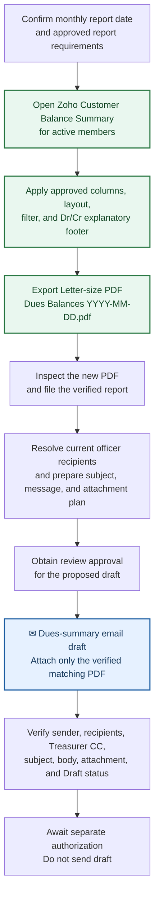

# Monthly dues summary

Run this lifecycle once each month after the reporting date and source records have been verified.

**Blue envelope boxes represent email drafts.** **Green boxes represent Zoho Invoice operations.**

## Export the report

1. In Zoho Invoice, open the Customer Balance Summary report.
2. Use the approved active-member filter and the approved columns: Customer Name, Member Type, Customer Email, Mobile Phone, Invoiced Amount, Amount Received, and Closing Balance.
3. Use the approved layout and include the explanatory footer defining Dr and Cr balances.
4. Export a Letter-size PDF named `Dues Balances YYYY-MM-DD.pdf`.
5. Inspect the newly created PDF before filing it in `Dues Summary Reports`. Do not substitute an older file merely because its name matches.

## Draft the email

1. Resolve current officer recipients from the authoritative officer roster; do not use stale examples.
2. Present the proposed subject, recipients, message, and attachment plan for review. The subject format is `SF Fil-Am LC Treasurer - Members Owing Dues as of <Month D, YYYY>`.
3. After approval, create an unsent Gmail draft from `treasurer@{club domain}`, CC the Treasurer role address, and attach only the verified matching report PDF.
4. Verify the sender, recipients, CC, subject, body, attachment filename, and Draft status.

## Formatting

When the approved Zoho-style format is requested, use Courier New, the club logo/header, generous spacing, and a bold all-caps title. Include the report date, member count, count of active members with a Dr balance, and the aggregate of individual Dr balances. Do not substitute a net balance where credit balances would reduce the amount owed. Include an editable Notes section and explain that the Closing Balance column shows what a member owes (Dr) or what the club owes the member (Cr).
