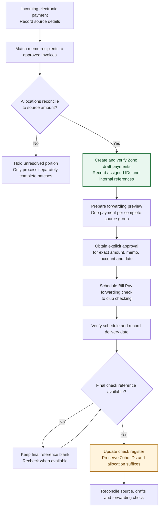

# Payments and forwarding

## Electronic payment forwarding lifecycle

This overview shows how an incoming electronic payment (including Zelle) moves from source reconciliation to the club's forwarding check. **A draft allocation is not a forwarding payment**, and no funds are forwarded without approval of the exact payment preview.

**Green boxes represent Zoho Invoice operations.** **Gold boxes represent Check Register operations.**

## Reconcile an electronic payment

1. Read the `{Lions Payments}` source row: date, status, sender, memo, amount, confirmation, and destination.
2. Match each person in the memo to an approved invoice and allocation. The allocation total must exactly equal the source payment.
3. If any name or remainder is unresolved, process only a separately complete and unambiguous batch.
4. Keep confirmation details in payment notes, not in a forwarding-check reference.

## Verify mobile check deposits

Use this procedure to determine whether checks deposited through the bank's mobile-deposit service have posted to the club account. A posted deposit is not proof that a deposited check cannot later be returned.

1. On the official online-banking site, select the exact club account and inspect the transaction activity. The authorized user must complete any password, MFA, or security challenge.
2. Treat a deposit as posted only when the bank labels the transaction as **Posted**. Record the bank-posted date, description, and amount; separately note any pending transaction, hold, or float.
3. Match each posted deposit to its source record using the available check number, payer, amount, and upload or deposit date. Do not infer a match from a shared amount alone.
4. If the bank does not expose a unique check-level identifier, retain the source evidence and report the deposit as amount-and-date matched; do not represent it as uniquely identified.
5. If an item is pending, held, missing, reversed, or cannot be matched unambiguously, leave the related accounting and register records unchanged and list it as unresolved.
6. After a complete match, update only the existing register fields that document the posted deposit, preserve the Zoho payment identifier and check reference, and move the row from the issued-but-not-posted section into the posted section above its marker. Re-read the source, register, and bank activity to verify the result.

## Online-payment tracker statuses

Use the source-row status to show the payment's evidence-backed lifecycle. Do not advance a row merely because an expected date has passed.

| Status | Required evidence |
| --- | --- |
| **Received — Awaiting Allocation** | The service payment is recorded, but its club allocation is not complete. |
| **Ready to Forward** | A complete, reconciled allocation is ready for the approved forwarding workflow. |
| **Check Scheduled** | The forwarding check is scheduled and its delivery date is recorded. |
| **Check Delivered** | The provider has supplied the final check reference and the forwarding entry has been verified. |
| **Club Reconciled** | The check has been mobile deposited, the matching deposit is marked Posted by the club bank, and the check-register row has a posted date. |
| **Not Club Funds** | Evidence shows the payment is not club money; do not include it in club-funds totals or forwarding. |

Move a row from **Check Delivered** to **Club Reconciled** only after all three posted-deposit conditions are verified. A mobile-deposit upload, a pending deposit, or a delivered check alone is insufficient.

## Create draft payment allocations

1. Create one Zoho draft payment per approved allocation with the correct customer, amount, payment date, mode, invoice allocation, and traceable reference.
2. Use an internal reference pattern appropriate to the source, such as `Z#XXX`, `C#XXX`, or `C#PENDING X`. Do not use a bank confirmation or a Zoho payment identifier as a check number.
3. Capture the Zoho-assigned payment identifier after creation; do not predict it.
4. Update all related draft-payment notes with the complete approved allocation breakdown.
5. Verify customer, amount, date, payment mode, invoice allocation, reference, notes, and Draft status.
6. Update `{Check Register}` and the current-year action log with the verified internal references and payment identifiers.

## Prepare and schedule forwarding payments

1. Proceed only after the electronic-payment allocations are complete and reconciled.
2. Prepare one forwarding payment per complete source group. Do not combine unrelated transactions merely to reduce payment count.
3. Prepare a preview listing source group, amount, exact memo, `{Club Checking Account}`, and proposed delivery date.
4. Obtain explicit action-time approval for the exact preview.
5. Use `{Club Treasurer's Personal Account for Electronic Payments}` only as the approved intermediary for electronic payments. Schedule the Bill Pay forwarding check to the club using the approved funding account and memo.
6. Verify the scheduled payment's amount, memo, funding account, check-delivery method, and estimated delivery date.
7. Record the final check reference only when available. Retain both the accounting-system payment identifier and final forwarding reference in `{Check Register}`.

## Reconcile after scheduling

1. Record the confirmed delivery date for each in-scope source record.
2. Leave the final check-reference field blank until the provider supplies it.
3. Re-read the edited records and verify that excluded or unallocated rows remain unchanged.
4. Once the final reference is available, replace only the pending forwarding reference while preserving allocation suffixes and accounting-system identifiers.
5. Verify final register entries against the source payment, forwarding check, and Zoho drafts.
6. When the club-bank deposit is independently verified as posted, record the register posted date and move the matching source row from **Check Delivered** to **Club Reconciled**.
