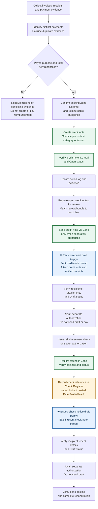

# Reimbursements and credit notes

Use a Zoho credit note when the club owes a reimbursable amount to a member or officer. A credit note records the obligation; it does not itself make a payment, apply a credit to an invoice, or confirm reimbursement.

## Reimbursement lifecycle at a glance

The credit note documents an obligation, **not a completed reimbursement**. Sending a credit note, sending a review request, applying credit, and paying a reimbursement are separate actions requiring their own authorization.

**Blue envelope boxes represent email drafts.** **Green boxes represent Zoho Invoice operations.** **Gold boxes represent Check Register operations.** The reimbursement review request and issued-check notice are replies in the same sent credit-note thread; preserve the thread subject and do not compose a new message for either follow-up.

## Reconcile reimbursement evidence

1. Inspect each source document before changing Zoho. Record the issuer, document number when available, relevant dates, amount, payer, and purpose.
2. Determine whether documents represent distinct payments or multiple evidence items for one payment. Do not reimburse a prior balance and its later payment confirmation twice.
3. Reconcile distinct reimbursable payments to the proposed credit-note total. Resolve missing payer, unclear amount, duplicate evidence, or unrelated charge before continuing.
4. Do not infer the reimbursement recipient or combine unresolved documents.
5. Use descriptive source and receipt names, such as `CRD-XXX Receipt 1 - Vendor Document.pdf`. When reimbursement copies are required, copy rather than move the verified source unless a move is explicitly authorized.

## Create and verify a credit note

1. Confirm the existing Zoho customer for the person owed. Do not create a duplicate customer for a spelling variation.
2. Reuse the matching reimbursable item when one exists. Otherwise create a clearly named service item using the approved current-year category convention.
3. In Zoho Invoice, create a Credit Note for the confirmed customer. Set the approved credit date, concise subject, and reference.
4. Add one line for each distinct reimbursement category or issuer. Each description must identify the payer, source documents, amount, and relevant purpose or date.
5. In Notes, list the supporting documents and dates. Preserve standard terms and template unless an approved exception applies.
6. Save the note without emailing, applying it to invoices, refunding it, or reducing its Open balance unless that separate action is authorized.
7. Verify the assigned identifier, for example `CRD-XXX`, customer, credit date, reference, lines, total, Open status, and credits remaining.
8. Attach supporting files to Zoho only when explicitly authorized. Local receipt files do not authorize uploading.
9. Append an action-log row for the new credit note and every newly created item. Include the identifier, customer, total, date, reference, line breakdown, Open status, and no-email result.

## Prepare open credit notes for review

1. List only Open credit notes and record each note's identifier, customer, date, reference, total, and credits remaining.
2. Before reimbursement processing, send the exact open credit note through Zoho only when authorized. Resolve the current Treasurer, Secretary, and Auditor recipients from the authoritative officer roster.
3. Reconcile every credit-note line item to exactly one supporting receipt bundle. A receipt must match the relevant line amount, not merely the note's overall total.
4. An authoritative external verification may replace a local receipt only when expressly approved. Record the verification and reason in the credit note's Notes while preserving Open status.
5. Compare the contents of possible duplicate receipts before removing one. Retain the more complete evidence bundle; delete a redundant copy only with explicit authorization.
6. Append action-log entries for every changed Zoho note. Record recipients by role, Open status, timestamp, and whether an email was sent.

## Draft the reimbursement review request

1. Create a Gmail reply draft in the sent credit-note thread, using `treasurer@{club domain}` and the Treasurer role CC.
2. Attach the same credit-note PDF and exactly one verified receipt bundle per credit-note line item.
3. Use the [Reimbursement credit review request template](email-templates.md#reimbursement-credit-review-request).
4. Verify the thread, sender, recipients, Treasurer CC, body, attachment filenames, and Draft status.
5. Do not send the draft or pay the reimbursement without separate authorization.

## Record an issued reimbursement check

Use this procedure after a separately authorized reimbursement check has actually been issued. Issuance is not bank posting or final settlement.

1. Confirm the issued check's payee, amount, date, and check reference against the exact Open Zoho credit note. For a multi-line credit note, reconcile the complete line allocation; do not infer a partial or combined payment.
2. In Zoho, record the refund against that credit note using the confirmed payment date, mode, amount, and check reference. Do not apply the credit to an invoice. Verify the resulting credit-note balance and status.
3. In `{Check Register}`, preserve the credit-note identifier and any allocation suffixes, enter the confirmed check reference, and leave the bank-posted date blank until the bank marks the check as posted. Move the row to the bottom of the issued-but-not-posted section, immediately before the next section marker.
4. If an issued-check notice is authorized, create an unsent Gmail reply draft in the existing sent credit-note thread to the verified reimbursement recipient using the [Reimbursement check issued notice template](email-templates.md#reimbursement-check-issued-notice). Send from `treasurer@{club domain}`; CC the Treasurer, Secretary, and Auditor roles resolved from the authoritative officer roster. Preserve the thread subject. Verify the thread, sender, recipient, all required role CCs, subject, check reference, payment date, amount, body, and Draft status. Do not send the draft without separate authorization.
5. Append an action-log entry for the Zoho refund and register update, including the credit-note identifier, amount, payment date, check reference, resulting status, whether a bank-posted date remains outstanding, and whether an email draft was created or sent.
6. After the bank posts the check, update only the register's posted-date field, move the row from the issued-but-not-posted section into the posted section above its marker, and verify the credit note, register, and bank activity still agree. Investigate any return, stop payment, reversal, or amount mismatch before making further changes.
